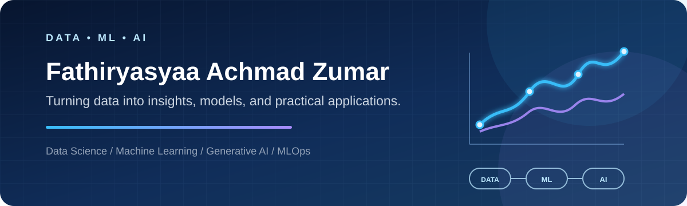

  

<h1 align="center">FATHIRYASYAA ACHMAD ZUMAR</h1>

  Informatics Student · Data Science Enthusiast · Machine Learning Explorer

  
  
  
  

---

## About Me

I am an Informatics student at **Universitas Gunadarma** with a growing focus on **data science, machine learning, generative AI, and practical data-driven applications**.

I enjoy transforming raw data into meaningful insights and building projects that connect analysis, predictive modeling, deployment, and real-world use cases.

- 🎓 Informatics student at Universitas Gunadarma
- 📊 Interested in data analysis, visualization, and machine learning
- 🤖 Exploring generative AI and image generation pipelines
- ⚙️ Learning MLOps, model deployment, and practical AI systems
- 🚀 Building projects to strengthen my end-to-end technical skills

## Areas of Interest

  
  
  
  
  

## Featured Projects

<table>
  <tr>
    <td width="50%" valign="top">
      <h3>🏦 Bank Customer Segmentation</h3>
      
Machine learning project focused on customer segmentation and classification for banking data.

      
    </td>
    <td width="50%" valign="top">
      <h3>🎨 Image Generation Pipeline</h3>
      
Stable Diffusion pipeline for text-to-image generation, inpainting, outpainting, and Streamlit interaction.

      
    </td>
  </tr>
  <tr>
    <td width="50%" valign="top">
      <h3>⚙️ MLOps Project</h3>
      
End-to-end profitability classification pipeline using TFX, TensorFlow Serving, and Prometheus.

      
    </td>
    <td width="50%" valign="top">
      <h3>🏨 Hotel Booking Prediction</h3>
      
Classification project comparing Logistic Regression, KNN, SVM, Random Forest, and XGBoost.

      
    </td>
  </tr>
  <tr>
    <td width="50%" valign="top">
      <h3>🌐 Hotel Booking Web App</h3>
      
Web application integrating a hotel booking system with a machine learning cancellation predictor.

      
    </td>
    <td width="50%" valign="top">
      <h3>🏠 Jakarta House Price Prediction</h3>
      
Random Forest house price prediction project with exploratory analysis and Flask deployment.

      
    </td>
  </tr>
</table>

## Tech Stack

### Data Science & Machine Learning

  
  
  
  
  
  

### Applications & Deployment

  
  
  
  
  

## Currently Learning

- Exploratory data analysis and data storytelling
- Model evaluation and feature engineering
- Generative AI workflows with diffusion models
- MLOps pipelines and model serving
- Building practical, data-driven web applications

## GitHub Activity

  
  

---

  <b>Learn continuously · Build practically · Turn data into useful solutions</b>

  

